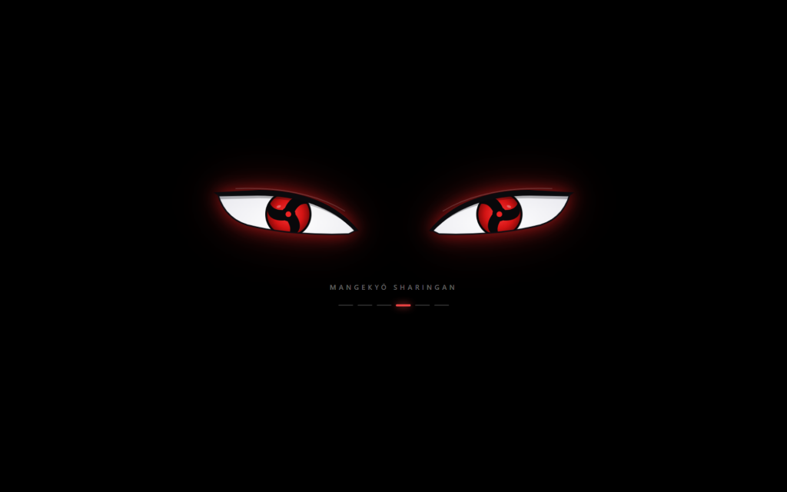
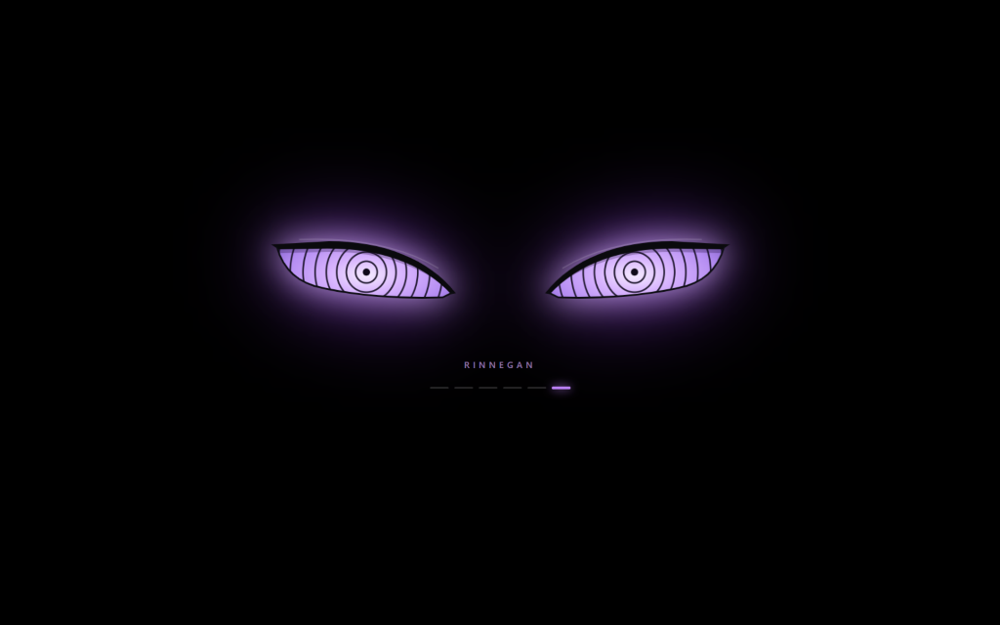

# Sharingan Evolution — Loading Animation

<div align="center">


**Ultra-clean, zero-dependency anime Loading Animation featuring all 6 stages of the Uchiha Dōjutsu evolution — from 1-Tomoe Sharingan to Rinnegan.**

</div>

---

## Preview

<table>
  <tr>
    <td align="center">
      
      <br />
      <sub><b>Stage IV — Mangekyō Sharingan</b></sub>
    </td>
    <td align="center">
      
      <br />
      <sub><b>Stage VI — Rinnegan</b></sub>
    </td>
  </tr>
</table>

---

## Evolution Stages

| Stage | Name | Visual Motif |
| :---: | :--- | :--- |
| **01** | **1-Tomoe Sharingan** | Single rotating tomoe, subtle crimson glow |
| **02** | **2-Tomoe Sharingan** | Dual opposing tomoe, faster rotation |
| **03** | **3-Tomoe Sharingan** | Fully matured 3-tomoe Sharingan |
| **04** | **Mangekyō Sharingan** | 3-blade sweeping shuriken pinwheel |
| **05** | **Eternal Mangekyō** | 6-point crimson star with fused 3-point core |
| **06** | **Rinnegan** | Concentric lavender ripples with pulsing purple aura |

---

## Features

- **Pure HTML + CSS + SVG** — Single self-contained `index.html`, no frameworks or build tools required.
- **Blink-to-Evolve Choreography** — Smooth eyelid blink transitions that swap stages cleanly while closed.
- **Interactive Controls** — Click directly on the eyes to evolve immediately, or click any of the 6 minimal progress bars to jump to a specific stage.
- **Responsive & Accessible** — Scales crisply to any screen resolution and respects `prefers-reduced-motion`.

---

## Quick Start

1. Clone or download this repository.
2. Open `index.html` directly in any modern browser.

### Deploy to GitHub Pages

1. Push this repository to GitHub.
2. Go to **Settings → Pages**.
3. Under **Build and deployment**, select **Deploy from a branch** → **`main`** / **`(root)`** → **Save**.
4. Your live site will be ready at `https://<your-username>.github.io/<repo-name>/`.

---

## Customization

Open `index.html` and adjust the timing constants at the bottom `<script>` block:

```js
const STAGE_HOLD_MS = 2800; // Time spent on each stage (ms)
const BLINK_TOTAL_MS = 410; // Eyelid blink duration (ms)
```

---

## License

MIT License — feel free to use and customize for your own projects.
